# Industrial Machine Monitoring using UDP

Real-time telemetry (temperature and vibration) from multiple simulated industrial
machines to a central monitoring server over UDP, with sequence-gap detection,
threshold alerts, and Wireshark-based performance analysis.

> Course project: Computer Network & Data Communication, VIT Vellore

## Team
* **Vaishnavi Thiruvengadam**
* **Sruthika Sivagami R**
* **Kritika P**


## Problem

Industrial machines (CNC mills, motors, turbines) continuously produce time-sensitive
sensor data that must reach a control room with minimal delay.
TCP's handshakes, retransmissions and head-of-line blocking add latency, and a
retransmitted reading is already stale when it arrives.

The full problem statement and design (Assessment 8) are in
[`docs/problem-statement.md`](docs/problem-statement.md).

## Solution

A lightweight, connectionless UDP architecture that prioritises **data freshness over
delivery guarantees**:

- Each machine sends JSON telemetry datagrams to the server
- The server validates each packet, detects missing packets via sequence numbers,
  and raises alerts on threshold violations
- Performance is evaluated with Wireshark under increasing client load

## Architecture

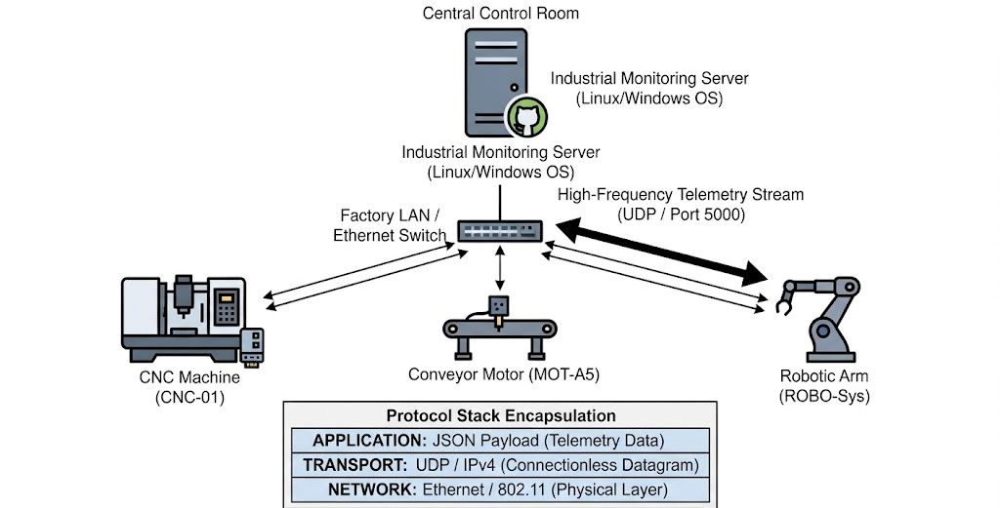

> The design diagram shows port 5000 and example machines (conveyor motor, robotic arm).
> The implementation uses **port 8080** and the three machines listed under [Machines](#machines).

| Layer       | Technology              |
|-------------|-------------------------|
| Application | JSON                    |
| Transport   | UDP (Python sockets)    |
| Network     | IPv4                    |
| Link        | Ethernet / loopback     |

Server: `127.0.0.1:8080`, `AF_INET` / `SOCK_DGRAM`, 1024-byte receive buffer.

### Packet format

```json
{
  "machine_id": "CNC-Machine-01",
  "sequence": 1,
  "timestamp": "2026-10-15T22:24:46.113047",
  "temperature": 76.81,
  "vibration": 2.39,
  "status": "RUNNING"
}
```

### Server logic

- Validates fields and sensor ranges (temp 0–200 °C, vibration 0–100 g)
- Tracks per-machine received count, missing packets (sequence gaps) and alerts
- Alerts: temperature > 80 °C, vibration > 7 g
- Measures one-way latency for every packet.
- On Ctrl+C prints a performance summary: duration, packet rate, throughput,
  average latency, and per-machine received / gaps / loss % / alerts

## Machines

| File         | Machine            | Interval | Temp (°C) | Vibration (g) |
|--------------|--------------------|----------|-----------|---------------|
| `client1.py` | CNC-Machine-01     | 1 s      | 60–90     | 2–8           |
| `client2.py` | Motor-Machine-02   | 0.5 s    | 55–95     | 1–9           |
| `client3.py` | Turbine-Machine-03 | 0.2 s    | 65–100    | 2–10          |

## Repository layout

```
industrial-udp-monitoring/
├── src/
│   ├── server.py         control-room server
│   ├── client1.py        CNC-Machine-01     (1 s)
│   ├── client2.py        Motor-Machine-02   (0.5 s)
│   └── client3.py        Turbine-Machine-03 (0.2 s)
├── docs/
│   ├── problem-statement.md   Assessment 8: problem and network design
│   ├── network-design.png
│   └── screenshots/           program output and Wireshark captures
└── captures/                  test_A / test_B / test_C .pcapng files
```

## How to run

Requires Python 3.8+. No external dependencies.

```bash
# Terminal 1
python src/server.py

# Terminals 2–4
python src/client1.py
python src/client2.py
python src/client3.py
```

Press Ctrl+C in each client, then in the server; the server prints its summary.

### Options

| Script       | Option          | Default     | Purpose |
|--------------|-----------------|-------------|---------|
| `server.py`  | `--host`        | `127.0.0.1` | IP to bind; `0.0.0.0` accepts clients from other machines |
| `server.py`  | `--port`        | `8080`      | UDP port |
| `client*.py` | `--server`      | `127.0.0.1` | IP of the monitoring server |
| `client*.py` | `--port`        | `8080`      | UDP port |
| `client*.py` | `--loss`        | `0`         | Percent of packets to skip, to test gap detection |

## Sample output

**Server** receiving telemetry and raising alerts:

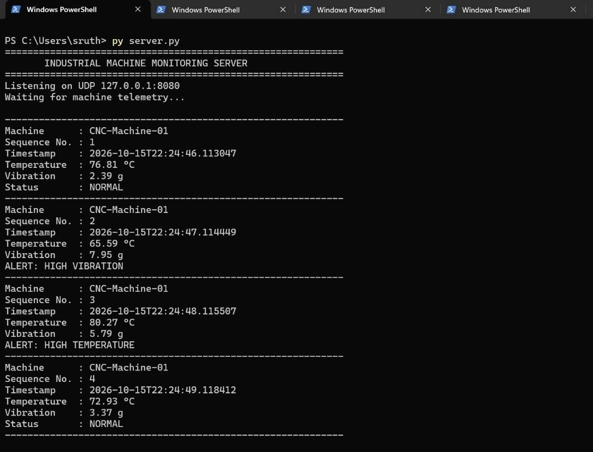

With all three machines sending at once:

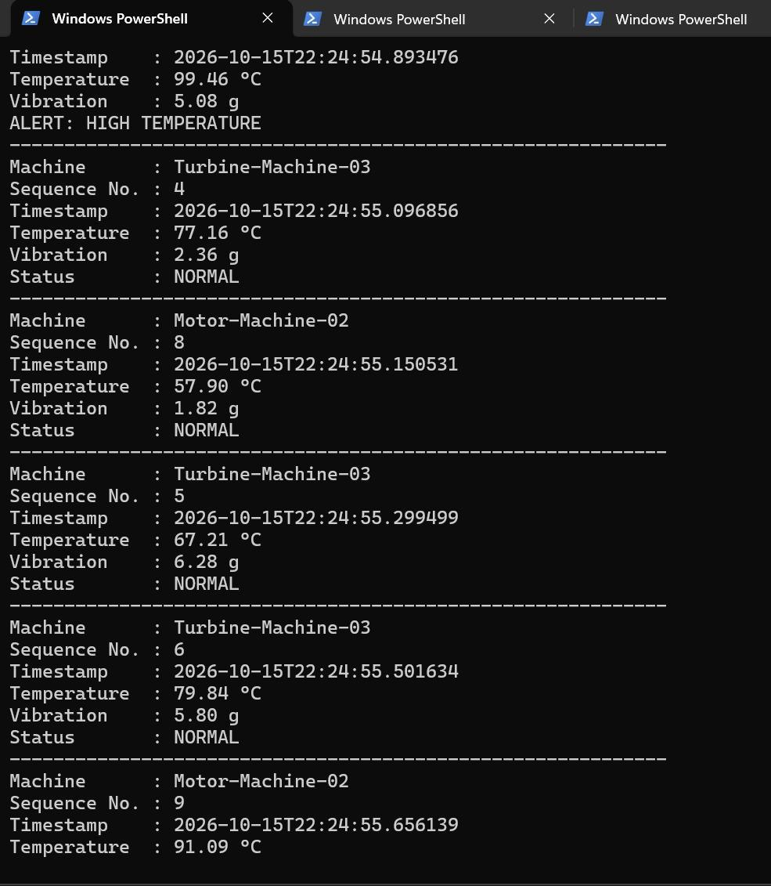

**Clients:**

| CNC-Machine-01 | Motor-Machine-02 | Turbine-Machine-03 |
|----------------|------------------|--------------------|
| 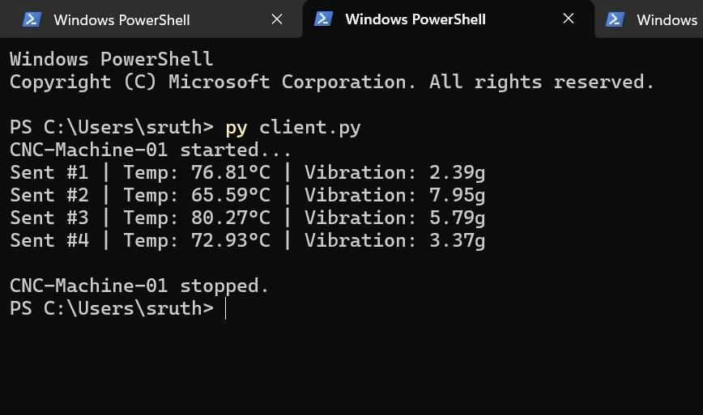 | 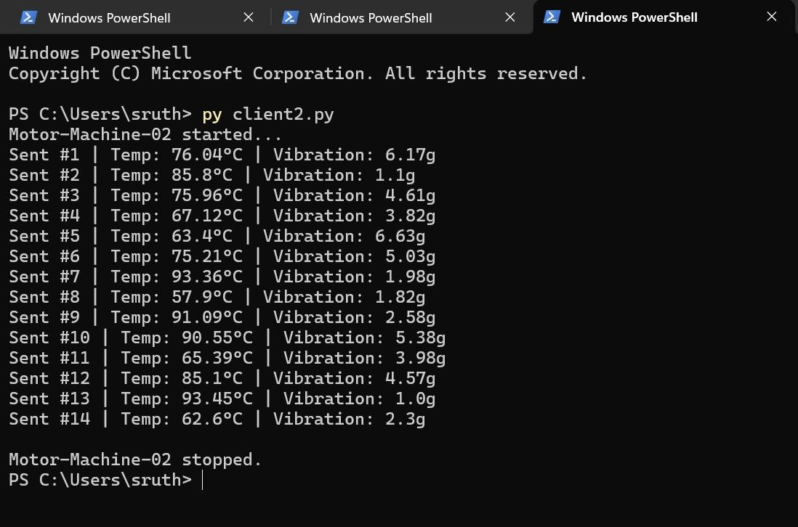 | 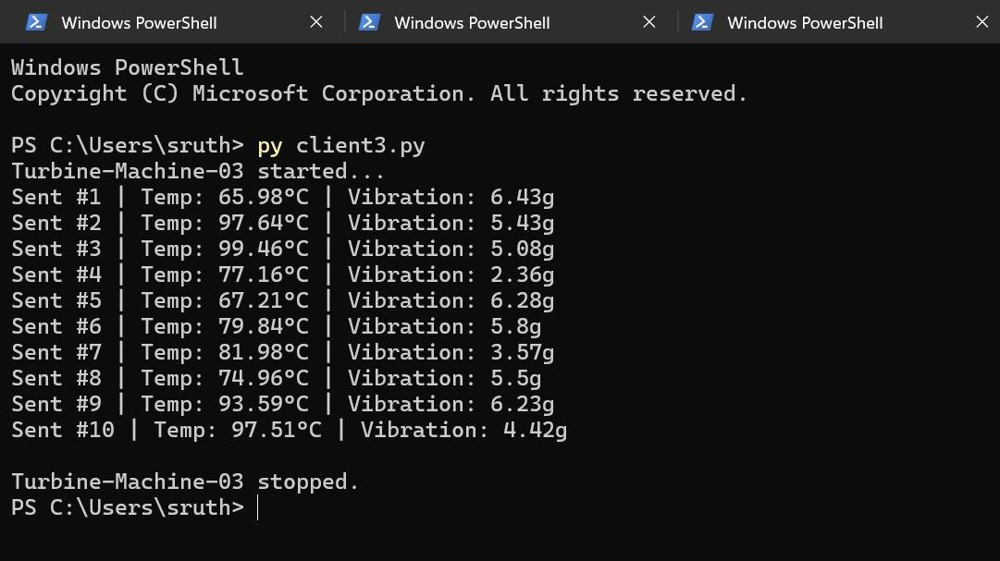 |

## Wireshark analysis

Captured on the **Adapter for loopback traffic capture** interface (Npcap) with the
display filter `udp.port == 8080`. Capture files are in [`captures/`](captures/).

One expanded packet shows the full protocol stack from the design:
**Null/Loopback → IPv4 → UDP → Data (152 bytes)**, with the JSON payload readable
in the hex pane.

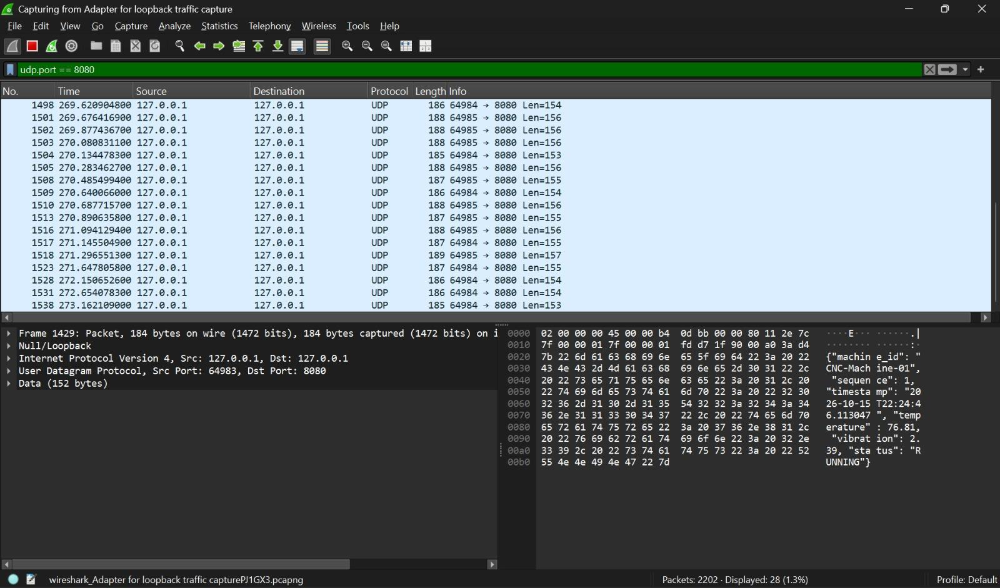

Each datagram carries 151–157 bytes of JSON payload. On the wire it is 183–189 bytes:
the payload plus 8 bytes of UDP header, 20 bytes of IPv4 header and the 4-byte
loopback header.

Wireshark reported **Dropped: 0 (0.0%)** at the end of the capture:

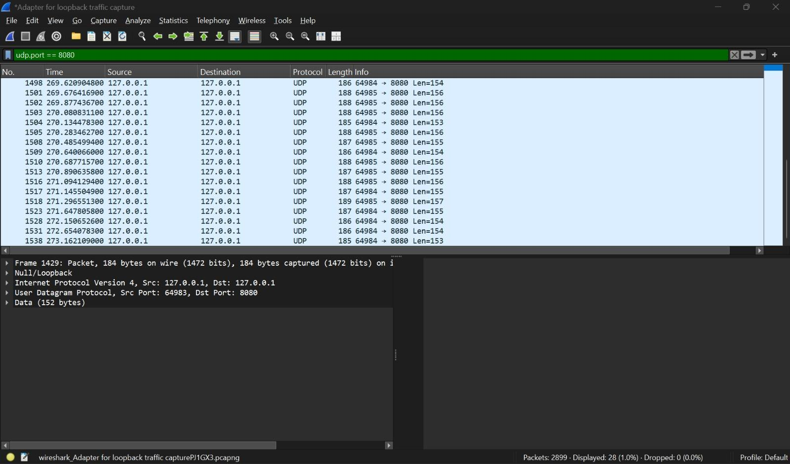

### Packet counts per test

| Test A: 60 packets | Test B: 180 packets | Test C: 477 packets |
|--------------------|---------------------|---------------------|
| 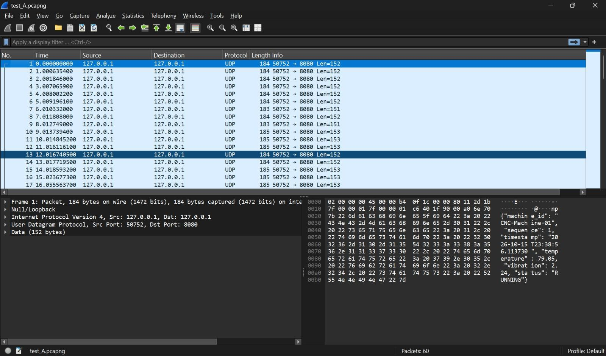 | 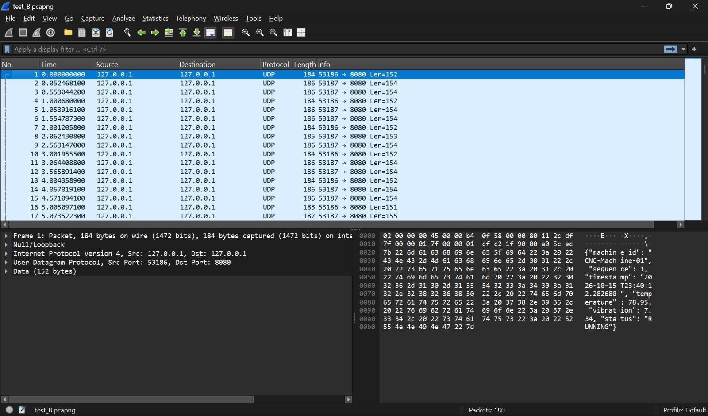 | 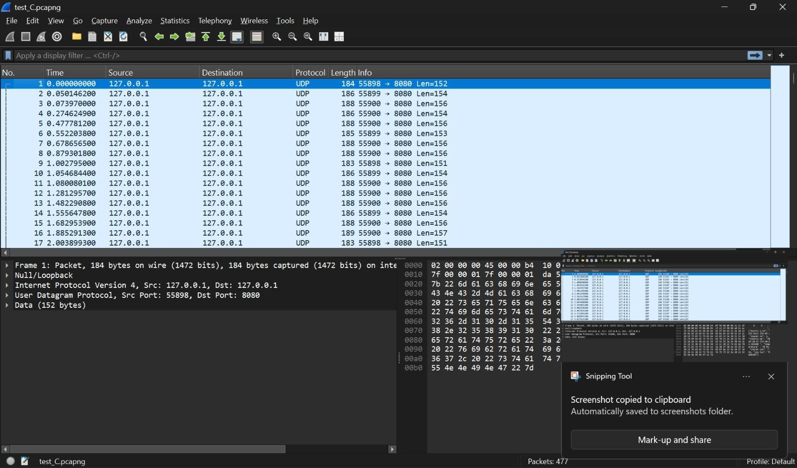 |

Each machine shows up as its own source port (e.g. 55898, 55899 and 55900 in Test C),
so **Statistics → Conversations → UDP** splits the traffic per machine.

## Performance evaluation

Each test ran for 60 seconds.

- **Test A (baseline):** `server.py` + `client1.py`
- **Test B (increased load):** `server.py` + `client1.py` + `client2.py`
- **Test C (multi-client monitoring):** `server.py` + all three clients

| Metric                                        | Test A   | Test B   | Test C    |
|-----------------------------------------------|----------|----------|-----------|
| Clients                                       | 1        | 2        | 3         |
| Duration (s)                                  | 60       | 60       | 60        |
| Expected packets (from send intervals)        | 60       | 180      | 480       |
| Packets sent by clients                       | 60       | 180      | 477       |
| Packets received by server                    | 60       | 180      | 477       |
| Packets captured by Wireshark                 | 60       | 180      | 477       |
| Bytes captured (frame bytes)                  | 11,078   | 33,507   | 89,774    |
| Application payload bytes                     | 9,158    | 27,747   | 74,510    |
| Observed packet rate (pkt/s)                  | 1.00     | 3.00     | 7.95      |
| Captured traffic rate (bits/s, frame bytes)   | 1,477    | 4,468    | 11,970    |
| Payload throughput (bits/s)                   | 1,221    | 3,700    | 9,935     |
| Packet loss (%)                               | 0        | 0        | 0         |
| Threshold alerts                              | 22       | 87       | 307       |

**Findings:** sent, received and captured counts matched in every test as load grew
from 1 to 7.95 packets per second, so no packet was lost.
Test C came in 3 packets under the theoretical 480 because each client loop takes slightly
longer than its sleep interval and the clients were started and stopped by hand; every
packet that was sent arrived.

### Latency results

Latency was measured in a separate run of the same three tests (60 seconds each, same
clients), using the updated `server.py`, which calculates it for every packet:

| Test | Clients | Packets sent | Packets received | Average latency (ms) |
|------|---------|--------------|------------------|----------------------|
| A    | 1       | 60           | 60               | 0.128                |
| B    | 2       | 179          | 179              | 0.155                |
| C    | 3       | 469          | 469              | 0.170                |

Average latency stayed under 0.2 ms at every load level and rose only slightly as
clients were added. No packets were lost in this run either.

### How latency is measured

Each client writes `datetime.now()` into the packet's `timestamp` field just before
sending. When the packet arrives, the server takes `datetime.now()` again and
records the difference as that packet's one-way latency. The summary reports the average
per machine and overall.

Because client and server run on the same machine, they read the same clock and no clock
synchronisation is needed. On Windows with Python older than 3.13 the system clock only
advances in steps of a few hundred microseconds or more, so single readings are coarse.
The average over hundreds of packets is still a fair estimate.

## Limitations

- **0% loss is expected on loopback.** All tests ran on `127.0.0.1`, where packets never
  leave the machine and UDP practically never drops them. The result shows the system
  works, not how it behaves on a congested or wireless network.
- UDP gives no delivery guarantee; the server can only detect gaps, not recover them.
- A gap is only noticed when a later packet from the same machine arrives, so losses at
  the very end of a stream go uncounted. A packet that arrives late (out of order) is
  still counted as missing.
- Latency measurement relies on a shared clock. Across two machines their clocks would
  need to be synchronised (e.g. NTP), otherwise the figure includes the clock offset.
- No authentication or encryption of telemetry.
- Sensor values are randomly generated.

### Seeing gap detection catch loss

The `--loss` option makes a client skip a percentage of its packets while still
advancing its sequence number, which is exactly what the server sees when the
network drops a datagram:

```bash
python src/server.py
python src/client3.py --loss 10
```

The server prints a warning such as `WARNING: 2 sequence gap(s) for Turbine-Machine-03`
whenever packets are missing, and its summary shows the matching packet-loss percentage.
In a 10-second trial with `--loss 20`, the client skipped 6 of 29 packets and the
server reported exactly 6 sequence gaps (20.69% loss) for that machine, while the two
machines without simulated loss showed 0%.

To test over a real network, run the server on one machine and the clients on another
(allow UDP port 8080 through the server's firewall):

```bash
# On the server machine
python src/server.py --host 0.0.0.0

# On each client machine, using the server's LAN IP
python src/client1.py --server 192.168.1.20
```

## Future work

- Run across a real LAN / Wi-Fi and inject loss with a network emulator (e.g. `tc netem`, clumsy)
- Add a live dashboard, persistent logging and TLS/DTLS
- Compare against a TCP implementation for latency under load

## License

[MIT](LICENSE)
